# nccl-energy-frontier

**How much GPU-board energy does an NCCL collective cost, and does NCCL's automatic
choice of algorithm and protocol leave energy on the table?**


A **pilot characterization study** of latency and GPU-board energy for NCCL
collectives (AllReduce, AllGather, ReduceScatter) across NCCL algorithms and
protocols. It was measured on one server: 8× RTX A6000, driver 580, NCCL
2.27.5, 2–4 GPUs.

It is **not** a general deployment claim, and **not** a completed proof of a
latency–energy tradeoff.

Energy values are NVML-reported estimates of participating-GPU board energy.
No external physical-energy reference or absolute error bound was established.

<p align="center">
  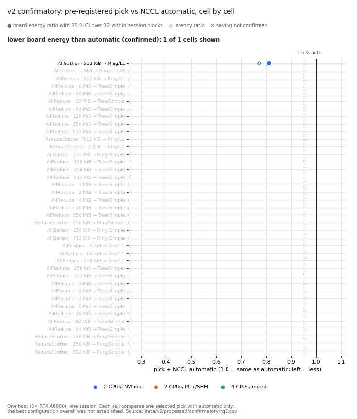
  <br>
  <sub><b>v2 confirmatory, replayed cell by cell.</b> Each row is one pre-registered cell: the dot is the
  board-energy ratio of the selected pick ÷ NCCL automatic (95 % CI over 12 within-session blocks), the
  diamond is the latency ratio. Left of the black line = less than automatic. Generated from
  <code>data/v2/processed/confirmatory/rq1.csv</code> by <code>scripts/make_readme_media.py</code>.</sub>
</p>

> [!NOTE]
> **Release status: v2.2 pilot release (2026-10-09, branch `ext/v2.2-audit`).**
> * The experimental scope is frozen. No further GPU campaign belongs to this
>   release.
> * The current claim status is in [`docs/release/claims.md`](docs/release/claims.md).
> * The final review report is in
>   [`docs/release/final_review_report.md`](docs/release/final_review_report.md).

> [!IMPORTANT]
> **Release-candidate corrections (2026-10-11).** This content was rebuilt from a
> sanitized export, not from the private Git history, and no new experiment was
> run. Historical data, protocols, pre-registration and frozen numerical outputs
> are unchanged. Current claim limits and literature support are in
> [`docs/release/scientific_resolution.md`](docs/release/scientific_resolution.md);
> presentation/code corrections are listed in
> [`docs/release/corrections_2026-10-11.md`](docs/release/corrections_2026-10-11.md).

## Completed A6000 measurement characterization (2026-10-14)

The [Stage 2 study](studies/a6000-stage2-v2.5/README.md) adds 3 smoke launches,
23 calibration launches and 72 accepted held-out launches on the same NVLink
pair, GPUs 4 and 5. The primary estimator is available for 70 of the 72
held-out launches. These are new, separately reported campaigns; they do not
replace or pool with the older results below.

For AllGather 2 MiB, LL128 versus automatic at 40 s used **+1.6454%**
NVML-reported board energy (descriptive 95% CI **[+1.0047%, +2.2901%]**).
The same-execution B/A control at 10 s was compatible with its prespecified
approximately ±0.5% mean-ratio equivalence margin. The precision target was
missed, every aggregate adequacy scope remains unmet/unestablished, and
global latency-versus-energy optima remain unresolved. The three sessions
ran on one host during the same evening, not independent days or machines.

Read the [results and limitations](studies/a6000-stage2-v2.5/docs/results.md),
[method and evidence](studies/a6000-stage2-v2.5/docs/methodology.md), or the
[50-page Persian educational guide](docs/teaching/NCCL_Energy_Frontier_FA.pdf).
This closes the bounded A6000 pilot; no Ti/Titan replication was performed
or is required for this release.

The older release banners above describe historical versions. Their private
branch name `ext/v2.2-audit` is not the public branch
`extension-pilot-reviewed` from which this addition was prepared.

## At a glance

| | |
|---|---|
| 🔬 **What was measured** | NVML board energy and latency of the participating GPUs for AllReduce, AllGather and ReduceScatter, 1 KiB–1 GiB, the tested automatic/Ring/Tree × automatic/Simple/LL/LL128 matrix where supported |
| 🖥️ **Where** | One host: 8× RTX A6000, NCCL 2.27.5, 2–4 GPUs, single node, FP32; sum where applicable |
| ✅ **Strongest result** | A pre-registered pick used less board energy than automatic in 36 of 39 cells |
| 📉 **Largest effect** | 4-GPU AllReduce 512 KiB, Tree/Simple vs automatic's Ring/LL: energy ratio 0.312 [0.308, 0.317] |
| ⚖️ **Open question** | Do latency and energy optima differ? **Unresolved**: the measurement-validation precision gate was not met |
| 🚫 **Not claimed** | Global optimum, real-model training benefit, whole-system energy, absolute sensor accuracy |

## Main findings

The category tags refer to the [evidence categories](#evidence-categories-never-pooled) below.

### 1 · Tested settings beat NCCL's automatic choice on this host `[v2 confirmatory]`

**Tested settings can substantially outperform NCCL's automatic choice on this measured deployment.**

* A pre-registered pick used less GPU-board energy than automatic in
  36 of 39 cells.
* By the pre-registered point-estimate rule, the saving was ≥ 5 % in
  25 cells. A separately identified threshold test supports ≥ 5 % in
  21 cells.
* The largest effect is 4-GPU AllReduce at 512 KiB, Tree/Simple vs
  automatic's Ring/LL: energy ratio 0.312 [0.308, 0.317].
* Scope: each cell compares one selected pick with automatic only. The
  best configuration overall was not established.
* The 12 blocks ran back to back in one session. They are within-session
  replicates, not independent days or hosts.

<details>
<summary>📊 <b>Show the per-block view and where automatic leaves energy on the table</b></summary>

<br>

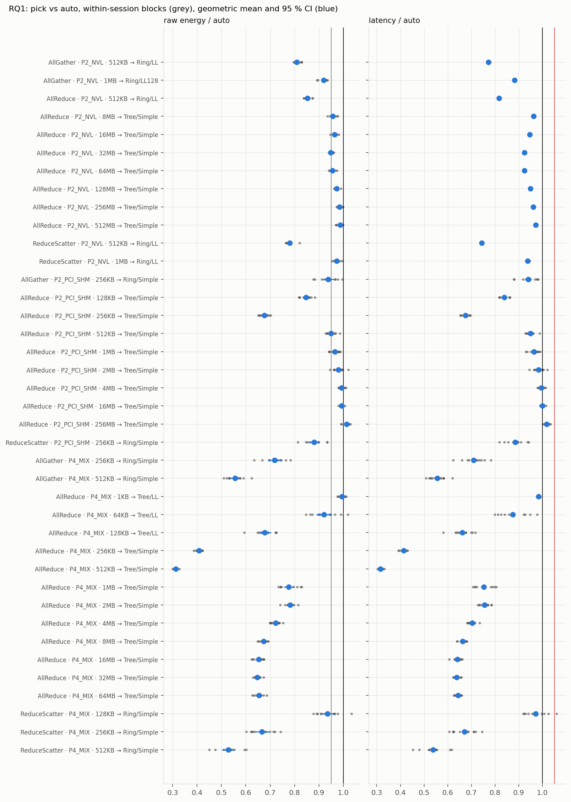

*Every grey dot is one within-session block; blue is the geometric mean and 95 % CI.*

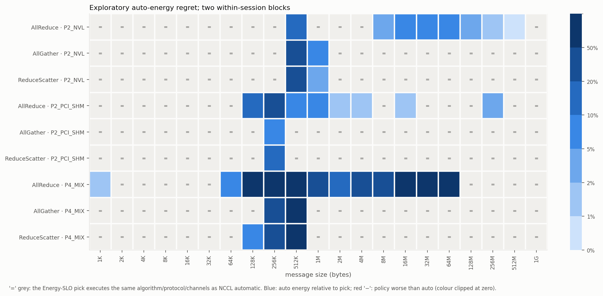

*Exploratory (two within-session blocks, before pre-registration): where the Energy-SLO pick differs from
automatic. `=` means the pick executes the same algorithm/protocol/channels as automatic.*

</details>

### 2 · Transfer to a synthetic training workload `[v2 Phase 10]`

**Transfer to a synthetic training workload shows promising improvements, with stated limitations.**

| Synthetic FP32 MLP, 4 GPUs, 5 within-session blocks | energy per step (policy ÷ auto) | note |
|---|---|---|
| DDP, batch 128 | 0.791 [0.784, 0.799] | step time 0.706 |
| DDP, batch 2048 | 0.885 [0.880, 0.889] | power-capped |
| FSDP (negative control) | 1.001 [0.973, 1.030] | within the original ±3 % energy-equivalence criterion |

> [!CAUTION]
> * Numerical equivalence was not recorded in these runs.
> * Every rank used the same synthetic batch. Under that setting a skipped
>   gradient AllReduce would not have been detected.
> * The meter of that time recorded no QC flags. A post-hoc plausibility
>   check of all 200 GPU readings found none implausible.
> * This says nothing about real models, BF16, time to quality or
>   whole-system energy.

<details>
<summary>📊 <b>Show every block of the workload runs</b></summary>

<br>

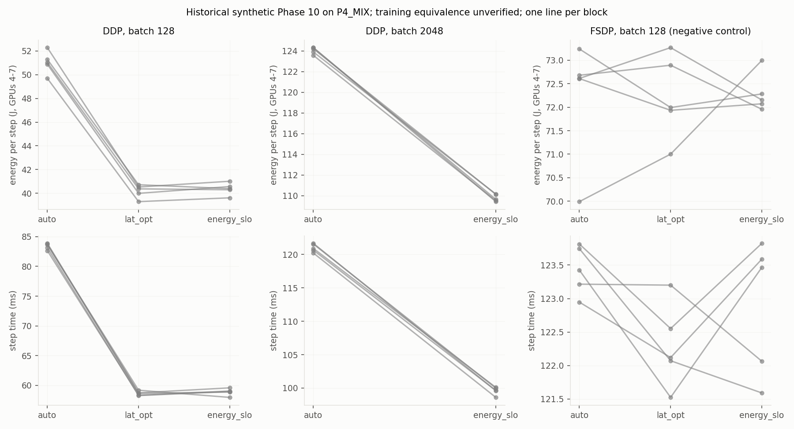

*One line per within-session block. Descriptive historical observation; training equivalence unverified.*

</details>

### 3 · Do the latency optimum and the energy optimum differ? Unresolved `[v2 + v2.2]`

**The small latency-versus-energy optimum difference was not resolved.**

* On the NVLink pair, AllGather 2 MiB with LL128 has 2.8 % lower latency
  than auto (equivalently, auto is 2.9 % slower than LL128).
* Its energy penalty is 1.012 [1.003, 1.022] with the energy counter. It
  is not robust across estimators.
* The v2.2 measurement-validation campaign: 70 of 72 processes accepted.
  Its pre-specified decisions were:

  | decision | pre-specified question | outcome |
  |---|---|---|
  | D1 | Is energy per op independent of region length (2.5 s vs 40 s, ±0.3 %)? | INCONCLUSIVE |
  | D2 | Do sampled-power estimators agree with the counter regardless of protocol (LL128 term, ±0.3 %)? | INCONCLUSIVE |
  | D3 | Do two identically executing configurations read the same (B ÷ A, ±0.5 %)? | SYSTEMATIC_OFFSET |
  | D4 | Is the 40 s interval precise enough (half-width ≤ 0.4 %)? | NOT_SUFFICIENT |

  The 40 s LL128 ÷ auto interval half-width was 3.98 %, against the ≤ 0.4 %
  needed.
* The claim (C7) stays **preliminary and unresolved**.

<details>
<summary>📊 <b>Show the estimator sensitivity and the identical-execution control</b></summary>

<br>

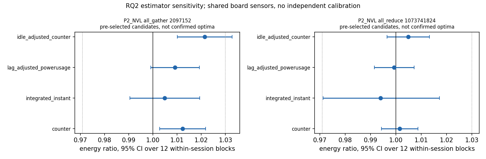

*Four estimators over the same shared board sensors disagree on whether the AllGather 2 MiB interval excludes 1.*

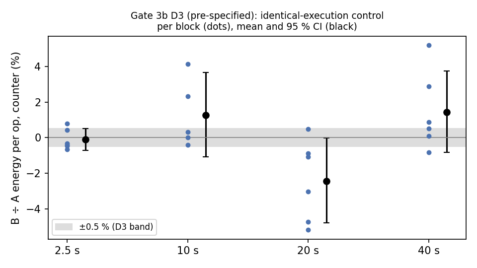

*Two configurations that execute identically should read the same. Their intervals are not contained in the
±0.5 % band (D3 = SYSTEMATIC_OFFSET, a frozen decision label, not proof of a persistent physical bias), so
measurement agreement at ±0.5 % is not established.*

</details>

### 4 · Historical pilot `[pilot v1, superseded]`

The first pilot (driver 550, uncorrected boundary counter reads, 3 of 5
trials) found the latency- and energy-optimal executed configuration
identical in 123 of 126 cells.

<p align="center">
  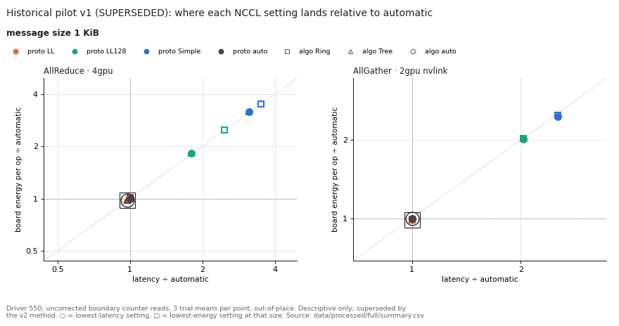
  <br>
  <sub><b>Historical pilot, swept from 1 KiB to 1 GiB (superseded, descriptive).</b> Each marker is one NCCL
  setting placed by latency ÷ automatic and board energy ÷ automatic; ○ marks the lowest-latency and □ the
  lowest-energy setting at that size. Generated from <code>data/processed/full/summary.csv</code>.</sub>
</p>

### Post-hoc exploration `[category 4]`

Post-hoc exploratory analyses of the validation campaign (category 4) suggest
two things to address in future designs:
* GPU thermal state is strongly associated with between-process energy
  variation;
* the counter and sampled board power differ by an unexplained, roughly
  constant amount per measured region.

Neither changes any decision above.

<details>
<summary>📊 <b>Show the post-hoc temperature association and the counter/sample gap</b></summary>

<br>

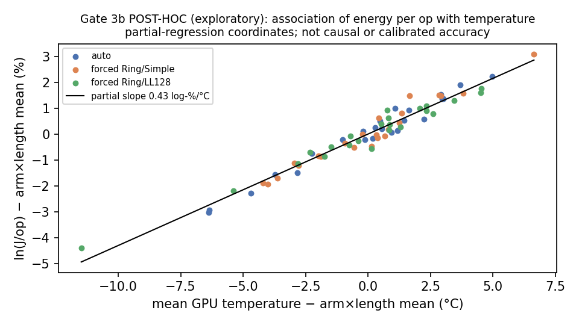

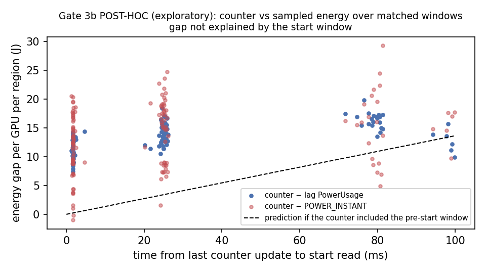

*Chosen after seeing the data; these generate hypotheses and support no claim.*

</details>

## Claim scoreboard

Full wording, numbers and sources: [`docs/release/claims.md`](docs/release/claims.md).

| status | claims |
|---|---|
| 🟢 **supported** | C1 pick < auto in 36/39 cells · C2 ≥ 5 % saving (21 cells) · C3 largest effect · C6 LL128 latency · C8 AllReduce 1 GiB Tree energy-equivalent · C9 PCIe 256 MiB reversal · C13 tuner reproduces executions · M1 pipeline smoke test · M2 no counter read inside a region · M3 Gate 3b ran as specified · M5 identical execution |
| 🔵 **supported, descriptive / association** | C4 picks are also faster · C11 energy–temperature association (not randomized) · C12 counter vs sampled power differ · C14–C16 synthetic workload ratios |
| 🟡 **preliminary / unresolved** | C2 (4 of the 25 cells) · **C7 latency vs energy optimum differ** · C10 order effects |
| ⚪ **not established / not assessed** | M6 measurement agreement ±0.5 % · M7 absolute accuracy · **M8 resolving a ≈ 1 % difference** · C18 real models, BF16, time to quality |
| 🔴 **unsupported** | C17 `no_sync` isolates communication energy · C19 tuner safe to deploy generally |
| 🧪 **exploratory (post hoc)** | H1 temperature association · H2 unexplained counter/sample gap · H3 temperature-adjusted ratio |
| ⚫ **superseded** | P1, P2 historical pilot |

## Evidence categories (never pooled)

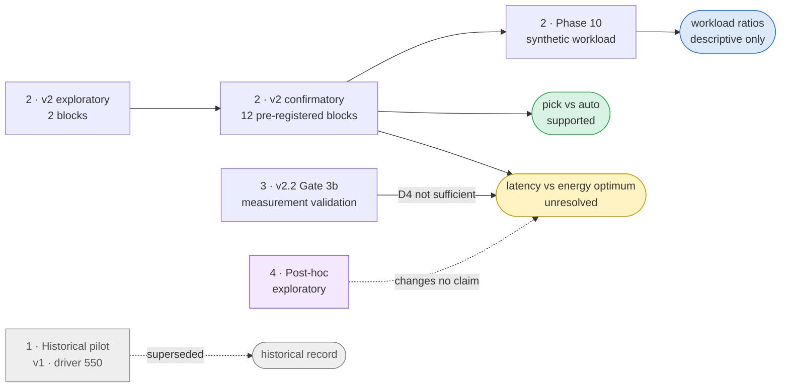

| # | category | method ID | data | documents |
|---|---|---|---|---|
| 1 | **Historical pilot** (2026-10-06): driver 550, uncorrected boundary counter reads, 3 trials | `v1` | `data/raw/`, `data/processed/`, `figures/full/` | [`docs/pilot_v1/README_pilot_v1.md`](docs/pilot_v1/README_pilot_v1.md), [`docs/methodology.md`](docs/methodology.md), [`docs/limitations.md`](docs/limitations.md) |
| 2 | **v2 exploratory and confirmatory** (2026-10-08/09): driver 580, commit-aligned counter region, 2 exploratory and 12 pre-registered confirmatory blocks, Phase 10 workload | `v2.1` | `data/v2/raw/`, `data/v2/processed/`, `figures/v2/` | [`docs/v2/`](docs/v2/), with Stage 2 corrections |
| 3 | **v2.2 measurement validation** (gate 3b, 2026-10-09): 6 blocks on GPUs 4,5, pre-specified D1–D4 | `v2.2-fail-closed`, `v2.2-aligned-meter-logged` | `data/v2.2/` | [`gate3b_measval_report.md`](docs/v2/v22_audit/gate3b_measval_report.md) §1–4 |
| 4 | **Post-hoc exploratory analysis**: reanalysis of the v2 data (Stage 2) and of the gate 3b data | — | `data/v2/reanalysis/`, `data/v2.2/processed/*/posthoc_temperature.json` | [`stage2_report.md`](docs/v2/v22_audit/stage2_report.md), gate 3b report §5 |
| 5 | **Future experiments**: not run, not needed for this release | — | — | [`docs/release/limitations.md`](docs/release/limitations.md) §6 |

> [!WARNING]
> **What "energy" means here**:
> * NVML board energy of the **participating GPUs** while the collective
>   runs.
> * It is **not** communication-only energy: it includes the boards' static
>   and idle power.
> * It is **not** whole-system energy: CPU, DRAM, PCIe switches, NVLink
>   bridges outside the board, and PSU losses are not measured.
> * No external power reference was used. Absolute accuracy is not
>   characterized.

<details>
<summary>🖼️ <b>Figure gallery: historical pilot (v1, superseded)</b></summary>

<br>

| | |
|---|---|
| 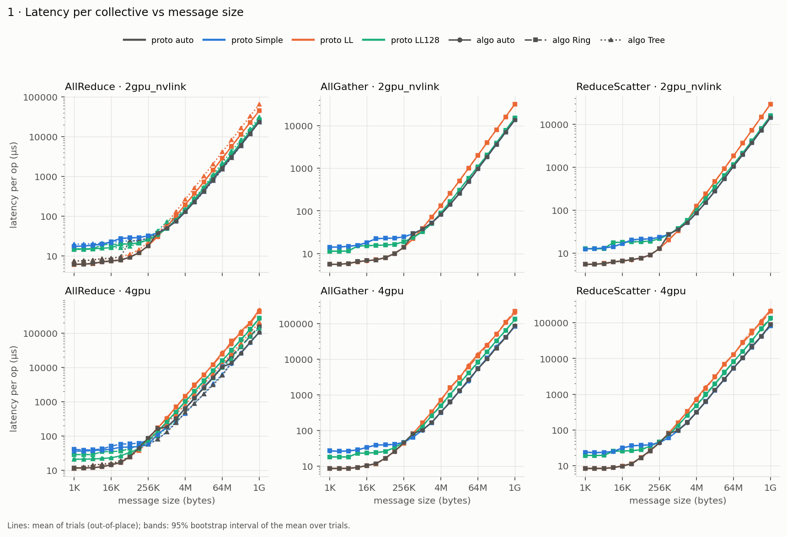 | 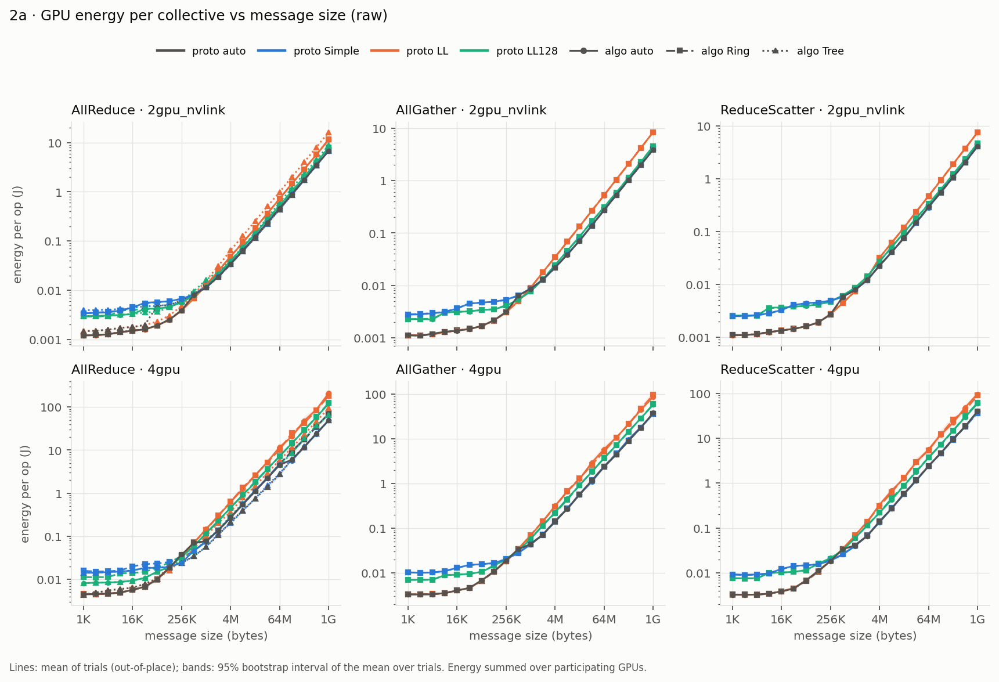 |
| 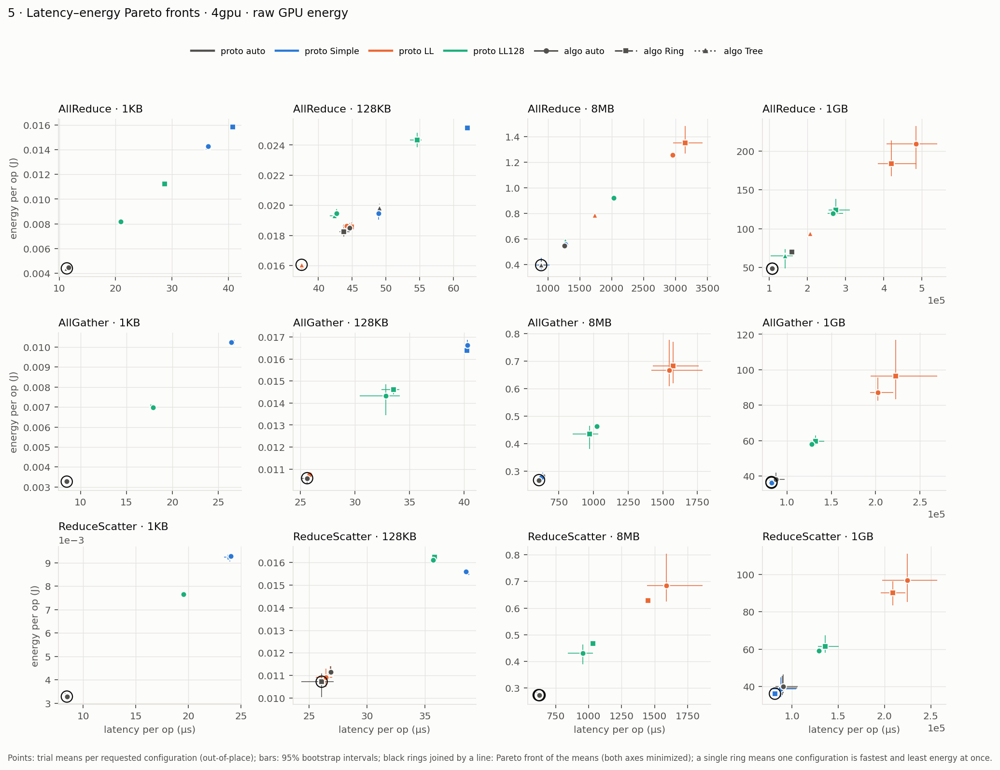 | 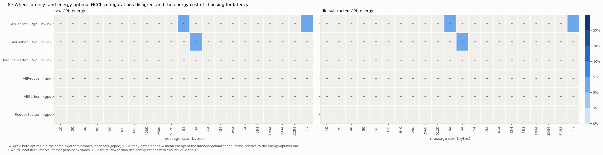 |

Frozen historical figures; every pilot figure is in [`figures/full/`](figures/full/).
Bootstrap intervals from three trials are descriptive at best.

</details>

The new [Stage 2 category](studies/a6000-stage2-v2.5/README.md) has its own
source, raw records, protocols and public-derivative replay. It is never
pooled with categories 1–4 above.

Historical v1 figure/table labels such as “ran” describe the initial-probe
inference, not TUNING recorded in every timed process. Those historical
artifacts remain unchanged; the newer profiler-verified execution evidence
is a different measurement category.

## Reproduce

For the completed Stage 2 study, after installing the analysis dependencies:

```bash
python studies/a6000-stage2-v2.5/scripts/reproduce_public.py
python -m unittest discover -s studies/a6000-stage2-v2.5/tests -p 'test_public_replay.py' -v
```

The replay verifies the public derivative manifest and frozen numerical
kernels before recomputing the raw-to-result analysis. It is not a claim
that privacy-transformed files match the original private freeze bytes.
See [publication status](studies/a6000-stage2-v2.5/docs/publication_status.md).
The historical commands below still apply only to their original categories.

**Analysis only** (CPU, no GPU, no NVML, no PyTorch), Python 3.11:

Use Linux for the supplied command-line tools: they import Linux process
control even in some analysis paths. Windows requires a separate adapter;
native Windows reproduction is not currently supported.

```bash
python -m pip install -r requirements-analysis.txt
```

```bash
PYTHONPATH=src python -m ncclenergy.v2.release_repro --out logs/release_repro/my_run
```

* `release_repro` re-runs the historical categories 1–4 from the retained
  evidence into the new directory. It compares each output file with the
  committed one and verifies that no frozen output changed.
* The full CPU test suite additionally needs PyTorch's CPU wheel, the
  `nvidia-ml-py` Python bindings (mocked; no NVIDIA driver required), GCC and
  Make. See the separate test installation commands below.
* Full commands, expected results and the sanitized-export check are in
  [`docs/release/reproduction.md`](docs/release/reproduction.md).

**Full CPU tests** (Linux):

```bash
python -m pip install -r requirements-tests.txt
python -m pip install --index-url https://download.pytorch.org/whl/cpu torch==2.9.1+cpu
python tests/run_tests.py
```

**README animations** (presentation only; reads retained processed tables, writes `docs/media/`):

```bash
python scripts/make_readme_media.py
```

<details>
<summary>⚠️ <b>Future GPU experiments (not part of this release)</b></summary>

<br>

* Experimental launch entry points that have not passed the current safety
  and numerical-validation gates are disabled in this release candidate.
* They need an explicitly allocated, idle-checked set of GPUs, at most four
  by default, one benchmark job at a time, with the watchdog and safety
  limits.
* See [`docs/release/reproduction.md`](docs/release/reproduction.md) §3.
  Enabled v2 runner commands require explicit allocation. Historical v1,
  Phase4 validation and CUDA workload launchers are disabled; guarded
  workloads and native sampled fallback still need real-hardware validation.

</details>

## Documents

| document | content |
|---|---|
| [`docs/release/claims.md`](docs/release/claims.md) | claim-status table with key numbers and sources |
| [`docs/release/methodology.md`](docs/release/methodology.md) | methods by evidence category |
| [`docs/release/limitations.md`](docs/release/limitations.md) | limitations, untested code paths, future experiments |
| [`docs/release/reproduction.md`](docs/release/reproduction.md) | analysis-only reproduction; future GPU commands with allocation and safety requirements |
| [`docs/release/change_ledger.md`](docs/release/change_ledger.md) | every number or statement that changed from an earlier report |
| [`docs/release/data_inventory.md`](docs/release/data_inventory.md) | data inventory and checksums |
| [`docs/release/integration_review.md`](docs/release/integration_review.md) | content-only public branch review; never merge private history |
| [`docs/release/validation_2026-10-11.md`](docs/release/validation_2026-10-11.md) | current local CPU tests and analysis reproduction, with validation boundaries |
| [`docs/release/final_review_report.md`](docs/release/final_review_report.md) | final review report of the extension |
| [`docs/v2/v22_audit/`](docs/v2/v22_audit/) | v2.2 audit: Stage 2 report, gate 3a and 3b reports, analysis-amendment record |

## Layout

```
src/ncclenergy/          pilot (v1) pipeline
src/ncclenergy/v2/       v2/v2.2: runner, QC, telemetry, meters, process control, watchdog, analyses, release tools
native/                  NCCL profiler plugin, example tuner (patched), guarded tuner
patches/                 nccl-tests region patch, tuner fixes
configs/                 campaign configs, frozen schedules, frozen analysis code (configs/v2.2/frozen_code)
data/, figures/          raw evidence (per-process directories on disk, see data inventory) and outputs
results/                 versioned release tables and figures
docs/media/              README animations (scripts/make_readme_media.py)
tests/                   CPU test suite (python tests/run_tests.py)
docs/                    reports (pilot_v1, v2, v2.2 audit, release)
```

## License

Project code is MIT; see [LICENSE](LICENSE). Bundled NVIDIA headers retain
their own copyright and license notices.
