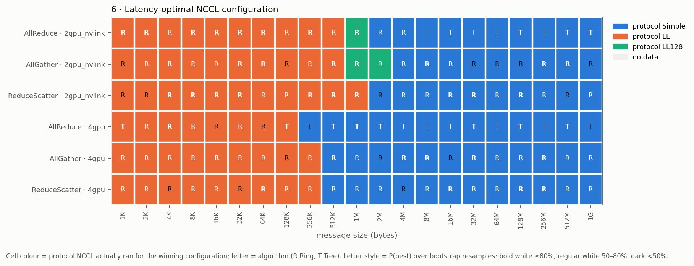
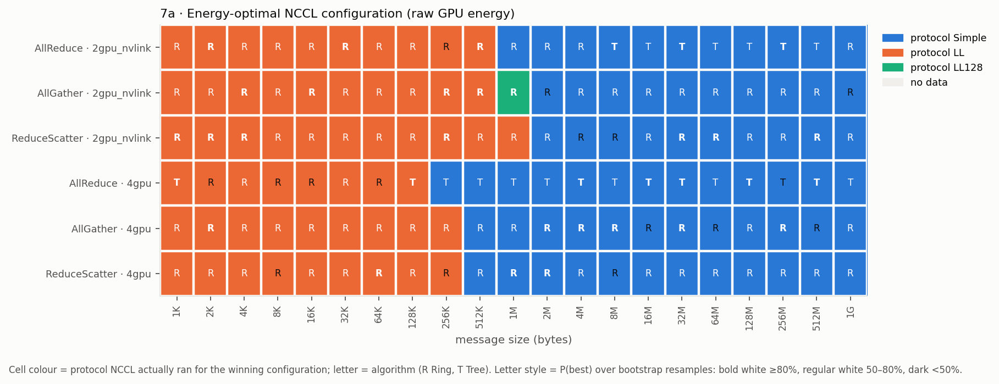
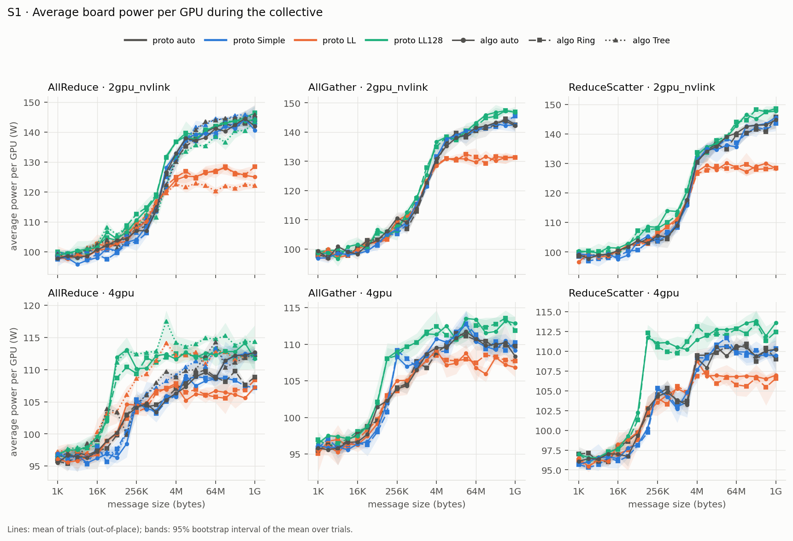

<!-- Frozen record of the pilot study (methodology v1). Moved verbatim from README.md (commit 8500116, lines 149-474) for the v2.2 pilot release; only relative link targets were adjusted for the new location. Numbers are unchanged and superseded by methodology v2 (see ../release/claims.md). -->

# Pilot study (methodology v1, 2026-10-06) — frozen, superseded by v2

The pilot measured energy with uncorrected boundary counter reads on driver
550. The effect of the counter-commit behaviour found in v2 Phase 4 was
not re-tested on driver 550. Use the v2 results above.


> **Status (2026-10-06):** one sweep completed with **3 of the 5 planned
> trials**. It was stopped after trial 3 so that the shared GPUs could be
> released (see *Deviations from the plan*). All results below come from
> those 3 trials (`data/processed/full/`). The numbers quoted here are copied
> from the generated [`results_summary.md`](../../data/processed/full/results_summary.md).

## Research question

**Do the NCCL configurations that minimize collective latency also minimize
collective communication energy?**

For each collective, GPU count and message size we compare 12 requested
configurations — algorithm ∈ {auto, Ring, Tree} × protocol ∈ {auto, Simple,
LL, LL128} — and ask whether the fastest one is also the one that uses the
least GPU energy per operation.

## Methodology (summary)

Full details: [docs/methodology.md](../methodology.md). Validation of the
pipeline: [docs/smoke_test.md](../smoke_test.md).

* **Benchmark.** Unmodified `nccl-tests` v2.21.1 (pinned commit) built against
  NCCL 2.27.5 (the NCCL bundled with PyTorch 2.9.1+cu128). One process per
  (collective, GPU set, configuration, message size), one thread per GPU.
* **Configuration control and verification.** `NCCL_ALGO` / `NCCL_PROTO` are
  set (or left unset for "auto"). A probe pass with
  `NCCL_DEBUG=INFO NCCL_DEBUG_SUBSYS=...,TUNING` records, for every size, the
  algorithm, protocol and channel range NCCL actually ran, checks results
  (`-c 1`), and records configurations NCCL rejects (e.g. Tree for
  AllGather/ReduceScatter) as unsupported instead of timing them. (A repeat
  of the probe after the sweep is part of the design but was not run for the
  reported sweep; see *Deviations*.)
* **Energy.** Primary: the NVML cumulative energy counter, read only at the
  boundaries of each measurement region. Regions are delimited by the moments
  nccl-tests prints the parts of its result row (stdout unbuffered). Secondary:
  a 50 ms NVML sampler (power, GPU/memory utilization, temperature, graphics
  and memory clocks, P-state, processes) whose integrated power is kept as a
  cross-check. Idle power of each GPU is measured separately (P8, no process).
* **Region length.** Iteration counts are calibrated so that the timed
  iterations in every region last ≥ 2 s; energy per operation is region energy
  divided by the number of operations in the region.
* **Design.** 5 repeated trial blocks planned (3 completed); independence
  across sequential blocks is unverified. Within each trial all units run in a
  seeded random order; competing GPU processes are detected and their launches
  excluded; every launch keeps its stdout, stderr, NCCL log and power trace;
  failures are recorded, never dropped.
* **Statistics.** Trial means with percentile-bootstrap 95 % intervals;
  per-cell optimal configuration with `P(best)`; energy penalty of choosing
  the latency-optimal configuration with a bootstrap interval; Pareto fronts.

Metrics per condition: latency per collective, algorithm bandwidth, bus
bandwidth, raw joules per operation, idle-subtracted joules per operation,
J/byte, GB/J, energy-delay product.

## Results

Everything in this section is measured. Interpretation is in the next section.
All numbers refer to the **out-of-place** measurement unless stated. The
in-place measurement gives the same latency-vs-energy verdict in 126 of 126 cells.

### What was run

| item | value |
|---|---|
| machine | 8× RTX A6000 (300 W limit), driver 550.144.03, 2× EPYC 7713, Ubuntu 24.04 |
| software | nccl-tests v2.21.1 (`afd59ab`), NCCL 2.27.5+cuda12.9, CUDA 12.4 `nvcc` |
| GPU sets | 2 GPUs = GPUs 4,5 (one NVLink bridge); 4 GPUs = GPUs 4–7 (two NVLink pairs joined over PCIe through host memory, NCCL `SHM/direct/direct`) |
| 8 GPUs | **not run**: GPU 1 was running another user's job when the sweep started (`data/raw/full/gpu_set_status.json`) |
| sizes | 1 KiB … 1 GiB, 21 powers of two |
| configurations | 3 algorithms × 4 protocols = 12 per collective |
| supported | 56 of 72 (collective, GPU set, configuration) conditions; all 21 sizes passed NCCL's data check (`#wrong = 0`) |
| unsupported | 16: `Tree` × {AllGather, ReduceScatter} × 4 protocols × 2 GPU sets. NCCL 2.27.5 rejects them (`no algorithm/protocol available`) at every size |
| forced configuration honoured | initial probe TUNING selections matched supported requests; timed-process selection was inferred, not verified individually; no closing probe |
| timed launches | 3 trials × 1,176 = 3,528, all `ok`; 406 needed one re-run because the first attempt's timed part was < 2 s; 0 regions excluded |
| measured regions | 7,056 (out-of-place + in-place); timed part ≥ 2.000 s in every region (region length median 2.30 s) |
| wall clock | 7.4 h of timed launches (00:32–07:58), plus 23 min probe and calibration |

**Measurement quality** (from `data/processed/full/qc.json`):

| check | value |
|---|---|
| region wall-clock per op ÷ nccl-tests time | median 1.0036, range 0.9955–1.0169 |
| ∫ sampled `PowerUsage` (window +0.5 s) ÷ energy counter | median 0.993, IQR 0.985–1.000, range 0.949–1.037 |
| idle power (P8, 27 windows per GPU, median) | GPU4 29.1 W, GPU5 20.8 W, GPU6 25.3 W, GPU7 27.2 W (min–max range ≤ 1.5 W per GPU) |
| power during collectives | 92.5–153.1 W per GPU; idle-subtracted energy = 72.5–83.7 % of raw energy |
| thermal / clock state | mean GPU temperature 32–41 °C (max 43 °C), mean graphics clock 1906–1939 MHz, P-state P2 in every region |
| sampler | median interval 50.0 ms (max 153 ms), 2.2 ms of NVML time per GPU per sample |
| competing processes on GPUs 4–7 | none detected during any timed launch |

**Run-to-run noise.** Within a cell, several requested configurations often
execute the same algorithm/protocol/channels (e.g. `auto/auto` and `Ring/LL`
for small messages). The differences between their means measure the noise
floor of a comparison:

| GPU set | pairs | energy/op: median / 95th pct / max | latency: median / 95th pct / max |
|---|---|---|---|
| 2 GPUs (NVLink) | 210 | 1.0 % / 2.6 % / 4.1 % | 0.14 % / 0.47 % / 0.87 % |
| 4 GPUs (NVLink + PCIe/SHM) | 208 | 1.6 % / 9.1 % / 20.7 % | 1.3 % / 9.5 % / 22.0 % |

The 4-GPU set is much noisier between trials than the 2-GPU set. In the
first two trials, 128 of 1,176 conditions differed by more than 5 % in
latency, and every one of them was a 4-GPU condition.

### Figures

| # | figure | file |
|---|---|---|
| 1 | latency vs message size | [fig1](../../figures/full/fig1_latency_vs_size.png) |
| 2 | energy/op vs message size (raw / idle-subtracted) | [fig2a](../../figures/full/fig2a_energy_per_op_vs_size.png), [fig2b](../../figures/full/fig2b_energy_dyn_per_op_vs_size.png) |
| 3 | GB/J vs message size (raw / idle-subtracted) | [fig3a](../../figures/full/fig3a_gb_per_j_vs_size.png), [fig3b](../../figures/full/fig3b_gb_per_j_dyn_vs_size.png) |
| 4 | energy-delay product vs message size | [fig4](../../figures/full/fig4_edp_vs_size.png) |
| 5 | latency–energy Pareto fronts | [2 GPU raw](../../figures/full/fig5a_pareto_2gpu_nvlink_raw.png), [4 GPU raw](../../figures/full/fig5a_pareto_4gpu_raw.png), [2 GPU idle-sub.](../../figures/full/fig5b_pareto_2gpu_nvlink_dyn.png), [4 GPU idle-sub.](../../figures/full/fig5b_pareto_4gpu_dyn.png) |
| 6 | latency-optimal configuration heatmap | [fig6](../../figures/full/fig6_heatmap_latency_optimal.png) |
| 7 | energy-optimal configuration heatmap (raw / idle-subtracted) | [fig7a](../../figures/full/fig7a_heatmap_energy_optimal.png), [fig7b](../../figures/full/fig7b_heatmap_dyn_energy_optimal.png) |
| 8 | where the two optima disagree | [fig8](../../figures/full/fig8_heatmap_disagreement.png) |
| S1–S3 | power per GPU; latency and energy relative to NCCL's default | [S1](../../figures/full/figS1_power_per_gpu_vs_size.png), [S2](../../figures/full/figS2_latency_rel_auto.png), [S3](../../figures/full/figS3_energy_rel_auto.png) |







### Latency-optimal vs energy-optimal

A "cell" is one collective × GPU set × message size (126 cells). A disagreement
means the latency-optimal and energy-optimal configurations ran a
**different** algorithm/protocol/channel range according to NCCL's log.
The penalty is the mean energy of the latency-optimal configuration relative to
the energy-optimal one.

| collective · GPUs | cells | disagree (raw E) | interval excludes 0 | largest penalty | disagree (idle-sub. E) | interval excludes 0 | disagree (EDP) |
|---|---|---|---|---|---|---|---|
| AllReduce · 2 | 21 | 2 | 1 | +3.3 % | 2 | 1 | 2 |
| AllGather · 2 | 21 | 1 | 1 | +2.3 % | 1 | 1 | 0 |
| ReduceScatter · 2 | 21 | 0 | 0 | — | 0 | 0 | 0 |
| AllReduce · 4 | 21 | 0 | 0 | — | 0 | 0 | 0 |
| AllGather · 4 | 21 | 0 | 0 | — | 0 | 0 | 0 |
| ReduceScatter · 4 | 21 | 0 | 0 | — | 0 | 0 | 0 |
| **total** | **126** | **3** | **2** | | **3** | **2** | **2** |

The three cells where the two optima differ:

| cell | latency-optimal (ran) | energy-optimal (ran) | energy penalty of the latency-optimal choice [95 % CI] | latency penalty of the energy-optimal choice [95 % CI] |
|---|---|---|---|---|
| AllReduce · 2 GPUs · 1 MiB | `auto/LL128` (RING/LL128) | `auto/Simple` (RING/SIMPLE) | raw +3.3 % [+2.1, +4.7]; idle-sub. +4.5 % [+3.0, +6.0] | +0.9 % [+0.6, +1.1] |
| AllGather · 2 GPUs · 2 MiB | `Ring/LL128` (RING/LL128) | `auto/Simple` (RING/SIMPLE) | raw +2.3 % [+0.9, +3.8]; idle-sub. +3.7 % [+1.7, +5.6] | +2.9 % [+2.5, +3.3] |
| AllReduce · 2 GPUs · 1 GiB | `Tree/auto` (TREE/SIMPLE) | `auto/Simple` (RING/SIMPLE) | raw +2.3 % [−0.4, +5.2] (interval includes 0) | — |

All three penalties (2.3–4.5 %) are about the size of the 2-GPU energy noise
floor above (95th percentile 2.6 %, max 4.1 %). The bootstrap intervals use
only 3 trials.

**Latency and energy rankings within a cell.** Across the distinct executed
configurations of a cell:
- The Spearman rank correlation between mean latency and mean raw energy has median 1.00 and minimum 0.50; it is the same for idle-subtracted energy.
- Latency varies by a factor of 2.42 (median max/min ratio across configurations).
- Average power varies by a factor of 1.05 (median), 1.20 at most.

**Protocol power vs time** (Ring, messages ≥ 64 MiB):

| GPUs | LL power per GPU | Simple power per GPU | LL time vs Simple | LL energy vs Simple |
|---|---|---|---|---|
| 2 | 125.7–131.7 W | 137.0–145.5 W | 1.73–2.35× | 1.59–2.12× |
| 4 | 105.5–108.5 W | 107.2–111.3 W | 2.20–2.89× | 2.14–2.80× |

Paired by collective and size, LL draws 0.88–0.94× the power of Simple on 2 GPUs and 0.96–1.01× on 4 GPUs. It takes longer, though, so it uses more energy.

### NCCL's default choice vs the best measured configuration

- **What NCCL picked.** With `NCCL_ALGO`/`NCCL_PROTO` unset, NCCL 2.27.5 picked:
  - 2 GPUs: Ring/LL up to 256 KiB, then Ring/Simple, for all three collectives.
  - 4 GPUs, AllGather and ReduceScatter: Ring/LL up to 512 KiB, then Ring/Simple.
  - 4 GPUs, AllReduce: Ring/LL up to 512 KiB, Ring/Simple from 1–64 MiB, then Tree/Simple from 128 MiB.
- **Where it was beaten.** In 25 of 126 cells a different executed configuration had lower mean energy than NCCL's choice; in 28 cells, lower mean latency. The default was more than 10 % above the best in 16 cells for energy and 16 for latency:
  - AllReduce on 4 GPUs from 128 KiB to 64 MiB: Tree beat NCCL's Ring choice. The default was 19 % to 2.06× slower and used 15 % to 2.03× more energy. The largest gap is at 512 KiB: Tree/Simple took 80.3 µs [79.96, 80.83] and 34.4 mJ, versus 165.4 µs [164.25, 166.42] and 69.8 mJ for NCCL's Ring/LL.
  - Around NCCL's LL→Simple switch point, the default was 6.5 % to 31 % above the best in energy, with similar latency excess. This covers 512 KiB for every other collective/GPU-set combination, and 1 MiB for AllGather and ReduceScatter on 2 GPUs.
  - AllReduce on 2 GPUs from 8 to 64 MiB: Tree/Simple beat NCCL's Ring/Simple by 2.8–6.2 % in energy and 3.9–8.2 % in latency.
- **Where it was fine.** In the other cells, NCCL's choice was the best or within the noise floor.

**Scale** (best configuration per cell):

| | 1 KiB, energy/op | 1 GiB, energy/op | 1 GiB, raw GB/J |
|---|---|---|---|
| 2 GPUs | 1.08–1.21 mJ | 3.9–6.7 J | 0.16 (AllReduce) to 0.28 (AllGather) |
| 4 GPUs | 3.3–4.4 mJ | 36–49 J | 0.022 (AllReduce) to 0.030 (AllGather/ReduceScatter) |

### Deviations from the plan

- **Trials.** 3 of the 5 planned trials were completed. After trial 3 the run was stopped at the operator's request to free the shared GPUs. The stop is logged in `data/raw/full/events.jsonl`, and no trial-4 launch was started. The ≥ 5-trial requirement is therefore **not met**, and every interval here comes from 3 values per condition.
- **Closing probe.** The probe pass after the sweep (`probe_end`) was not run, so the stability of NCCL's selection was checked only in the smoke run (108/108 stable), not in this sweep.
- **8 GPUs.** The 8-GPU set was not run (see *What was run*).

## Interpretation

These statements go beyond the measurements and should be read with the
limitations below.

- **On this machine, the answer to the research question is "almost always yes".** In 123 of 126 cells, the configuration that minimized latency also minimized GPU energy. The same holds for idle-subtracted energy (123/126) and EDP (124/126).
- **The simplest reading of the data is that time dominates energy.** Board power during the collectives ranged from 92 to 153 W per GPU depending mostly on message size. Within a cell, the configurations differed by about 5 % in power (median; at most 1.2×) but by about 2.4× in time. Energy per operation is approximately power × time, so the energy ranking follows the latency ranking. The LL protocol at ≥ 64 MiB is the clearest case: on 2 GPUs it lowers power by 6–12 % but takes 1.7–2.4× as long.
- **A disagreement requires the faster configuration's power excess to exceed its time advantage.** With power spreads of at most 1.2× in a cell, that is only possible where latencies are close. In two of the three observed cases (NVLink pair, 1–2 MiB), LL128 was 0.9–2.9 % faster than Simple but drew enough extra power to use 2.3–3.3 % more raw energy (3.7–4.5 % idle-subtracted). In the third (AllReduce, 1 GiB), Tree/Simple beat Ring/Simple on latency, and its energy penalty interval includes 0. These penalties are the same size as the measured noise floor, so they are not evidence of a meaningful latency–energy trade-off; they are only consistent with one. An earlier, separate run (the smoke test, 2 trials) showed the same LL128-vs-Simple split at AllReduce · 2 GPUs · 1 MiB.
- **On this system, a larger energy cost comes from NCCL's default selection than from any latency–energy conflict.** Where NCCL's default was not the fastest configuration, it usually also used more energy, by up to about 2× for 4-GPU AllReduce at mid-size messages. Choosing for latency would have saved energy too. This is specific to this topology (NVLink pairs joined over PCIe/SHM) and NCCL version.
- **Idle-subtracted energy did not change any conclusion.** Subtracting idle power removes 16–28 % of raw energy roughly in proportion to time. It makes the relative differences between configurations somewhat larger but did not create new disagreements.

## Limitations

The full list is in [docs/limitations.md](../limitations.md). The ones most
likely to change a conclusion:

* One machine, one GPU model (RTX A6000, pairwise NVLink, no NVSwitch), one
  driver (550.144.03), one NCCL version (2.27.5).
* GPU board energy only: CPU, DRAM and PCIe-switch energy are not measured.
  This matters most for the 4-GPU set, where NCCL routes half of the ring
  through host shared memory.
* Isolated back-to-back collectives; no overlap with compute.
* **Only 3 trials per condition** (5 planned). Bootstrap intervals from three
  values are descriptive at best, and `P(best)` is coarse.
* The 4-GPU set has large run-to-run variation: up to about 20 % between
  trials of the same configuration, of unidentified origin. The machine is
  shared and other users' CPU load is a plausible contributor.
* The disagreements found (2–5 %) are no larger than the noise floor.

## Reproduce

Requirements: Linux, NVIDIA driver with NVML, CUDA toolkit (`nvcc`), a Python
3.11 environment with the packages in `requirements.txt`, `numactl`,
`stdbuf` (coreutils). No root access is needed.

```bash
git clone <this repository> nccl-energy-frontier
```

```bash
cd nccl-energy-frontier
```

Point `PYTHON` at the environment (default in `scripts/env.sh`:
`~/miniconda3/envs/ai_scientist/bin/python`) and `CUDA_HOME` at the toolkit:

```bash
export PYTHON=$HOME/miniconda3/envs/ai_scientist/bin/python CUDA_HOME=/usr/local/cuda-12.4
```

```bash
$PYTHON -m pip install -r requirements.txt
```

Build nccl-tests (pinned commit) against the NCCL in that environment:

```bash
bash scripts/build_nccl_tests.sh
```

Unit tests and the smoke test (≈30 min; writes
`data/processed/smoke/SMOKE_REPORT.md`, exits non-zero if a check fails):

```bash
bash scripts/run_smoke.sh
```

Full sweep (≈2.5 h per trial on this machine plus ≈25 min of probe and
calibration, i.e. ≈13 h for 5 trials; resumable — re-run the same command
after an interruption, or stop it with Ctrl-C/SIGTERM between trials):

```bash
bash scripts/run_full.sh
```

Analysis and figures:

```bash
bash scripts/analyze.sh full
```

GPU indices, GPU sets, sizes, configurations, trial count, region length and
sampler period are all in `configs/full.yaml`. Edit `gpu_sets` for another
machine; GPU indices are `nvidia-smi` indices.

## Repository layout

```
configs/                 experiment definitions (smoke.yaml, full.yaml)
scripts/                 build, run, analyze, archive (bash, copy-paste reproducible)
src/ncclenergy/
  orchestrate.py         experiment orchestration: probe, calibration, randomized trials, idle
  nvml_sampler.py        NVML telemetry sampler (power, util, temperature, clocks, P-state)
  energy.py              energy counter reads, trapezoidal integration, idle measurement
  nccl_parse.py          nccl-tests stdout and NCCL_DEBUG log parsing
  metadata.py            machine/software metadata capture
  stats.py               bootstrap intervals, P(best), penalties, Pareto fronts
  analyze.py             raw -> processed tables
  plots.py               figures
  smoke.py               smoke-test validation report
tests/                   parser/statistics tests on real captured output
data/raw/<run>/          per-run config, metadata, randomized orders, event log;
                         per-launch artifacts (git-ignored, see below)
data/processed/<run>/    CSV tables and qc.json
figures/<run>/           figures
docs/                    methodology, limitations, smoke-test report
third_party/             nccl-tests checkout and NCCL symlinks (built, git-ignored)
```

## Data

* `data/raw/<run>/launches.jsonl` — one JSON record per launch attempt,
  probe, calibration and idle measurement (append-only).
* `data/raw/<run>/launches/<id>__a<k>/` — `stdout.txt`, `stderr.txt`,
  `nccl.log.gz`, `power.csv.gz` (sampler trace), `chunks.json` (stdout chunk
  arrival times with energy-counter reads), `result.json`.
* `data/raw/<run>/metadata_{start,end}/` — machine metadata (contains host
  name, GPU UUIDs and serial numbers).

Per-launch artifacts and `launches.jsonl` are large and contain the host name
and private network addresses printed by NCCL, so they are git-ignored;
`scripts/archive_raw.sh <run>` packs them into one archive.

## License

MIT — see [LICENSE](../../LICENSE).
