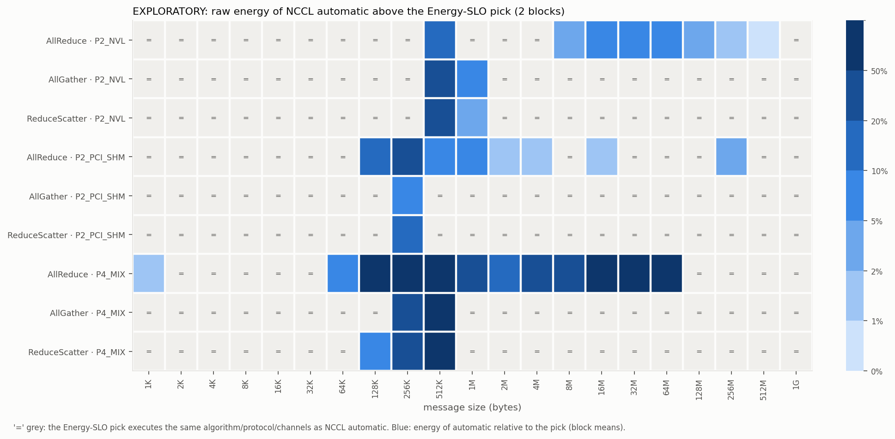

# Phase 5 — exploratory screen (label: EXPLORATORY)

All numbers below are exploratory. They were used to choose the
confirmatory matrix, candidate configurations, iteration schedule and block
count (Phase 6). They are not confirmatory evidence.

* **Raw data**: `data/v2/raw/exploratory/blocks/block_0{1,2}`.
* **Processed data**: `data/v2/processed/exploratory/`.
* **Figures**: `figures/v2/exploratory/`.

## Runs

| item | value |
|---|---|
| blocks | 2, both `COMPLETE` (87 and 89 min, 2026-10-08 22:22–01:18 UTC), GPUs 4–7, ≤ 4 concurrent, one process at a time |
| matrix per block | 3 placements × 3 collectives × 21 sizes × allowed configurations = 777 executed units (+546 `NOT_RUN_NOT_ENABLED_BY_NCCL`) |
| final status (both blocks) | 1,542 `OK`, 11 `QC_SHORT` (region < 2.0 s; excluded, not re-run), 1 `EXCLUDED_DEVIATION` |
| configuration evidence | 1,554 / 1,554 executed units `VERIFIED` (profiler counts = w + R + 1 on every rank) |
| health | no HW-thermal or power-brake counter increase; idle power pre/post within 0.8 W per GPU; maximum region temperature 46 °C |
| counter vs ∫POWER_INSTANT | median 0.985, 5th–95th percentile 0.936–0.995 (1,542 regions); the gap is observed but its physical origin is unresolved (see gate 3b matched-window analysis) |

The excluded unit, `P2_NVL__all_gather__Ring-Simple__134217728` in block 1,
is excluded because the experimenter ran a capability check that read the
energy counters of GPUs 4–7 while the block was running. That unit's region
overlaps the read within timestamp resolution. The exclusion was recorded in
`deviations.jsonl` before its value was examined, and the script now refuses
to read counters on GPUs with any process.

`QC_SHORT` units: the sustained latency was shorter than the short
calibration runs predicted. Six of the 11 are P4_MIX ReduceScatter Ring/LL
(regions 0.96–1.96 s). This motivated sizing the confirmatory schedule from
the exploratory sustained latencies with `T* = 3.0 s` (Phase 6).

## Exploratory observations (two blocks, descriptive)

* **Latency and energy rankings coincide almost everywhere.** In 189 cells,
  the latency-optimal and energy-optimal *executed* configurations differ in
  2. Both are on the NVLink pair:
  * AllGather 2 MiB: LL128 2.8 % faster, 1.3 % more energy;
  * AllReduce 1 GiB: Tree/Simple 1.9 % faster, < 0.1 % more energy.

  The pilot (driver 550) singled out the same two cells. Across executed
  configurations within a cell, latency differs by 2.18× (median max/min)
  and average power by 1.032× (max 1.274×). The Spearman correlation of
  latency and energy is 1.00 (median) and 0.50 (minimum) over 104 cells with
  ≥ 3 executed configurations.
* **NCCL automatic is the energy-optimal choice in 150 of 189 cells.** In the
  other 39, the Energy-SLO pick runs something else. Automatic used a median
  13.7 % more energy than the pick there, and up to 3.2× more (P4_MIX
  AllReduce 512 KiB: automatic's Ring/LL vs Tree/Simple). These cells
  cluster in two places:
  * around NCCL's LL→Simple switch (256 KiB–1 MiB) on all placements;
  * AllReduce on P4_MIX from 128 KiB to 64 MiB (Tree beats Ring), and on
    P2_NVL from 8 MiB to 256 MiB.
* **Bimodal automatic latency on the 4-GPU host path.** For P4_MIX
  ReduceScatter at 512 KiB, automatic's Ring/LL took 90 µs in block 1 and
  160 µs in block 2. Ring/Simple was stable at 82 and 77 µs. This is the
  largest block-to-block SD of any RQ1 cell (paired log-energy SD 0.445), and
  it is why the block count reaches its cap.

## Inputs frozen for Phase 6

* **Candidate sets**: `data/v2/processed/exploratory/candidates.json`.
* **Policies**: `policies.csv`.
* **Paired SDs**: `paired_vs_auto.csv`.
* **Pre-registration**: [`prereg.md`](prereg.md). All of these were hashed
  into it before any confirmatory block.
