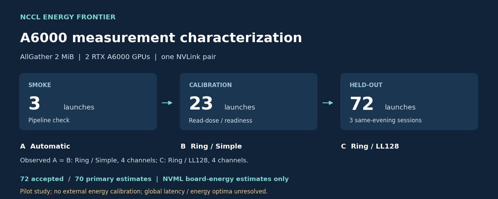
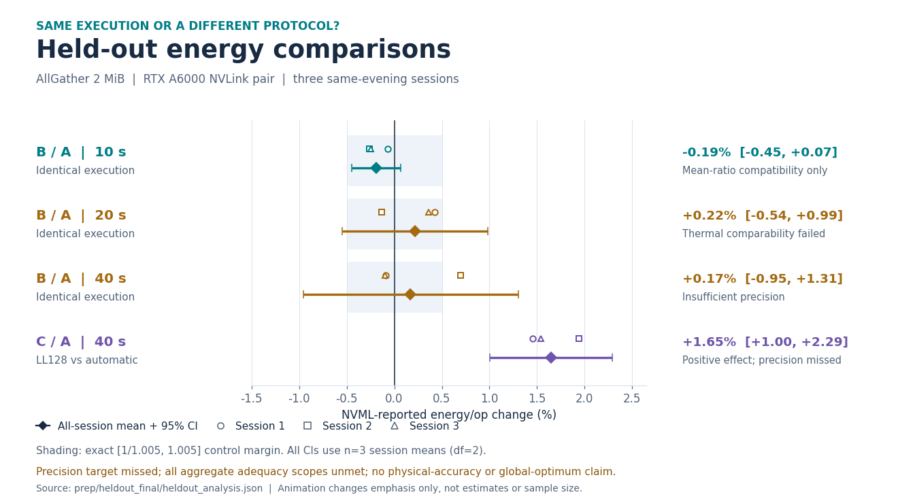
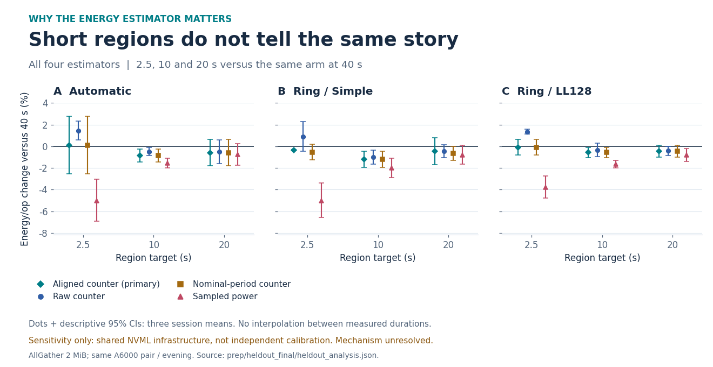
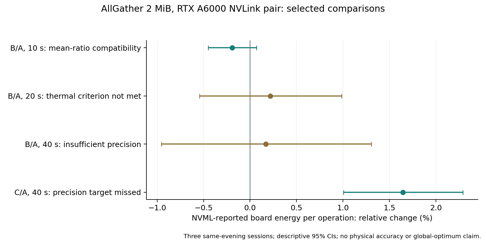

# A6000 Stage 2: measurement characterization and held-out comparison

This is a completed **pilot characterization study** of NVML-reported participating-GPU board energy. It adds a smoke test, a calibration session and three held-out sessions to the earlier NCCL energy pilot. Older campaigns remain separate: their estimators, preparation and decision rules are not interchangeable. [Stage 2 (2026/10), [protocol](protocol/STAGE2_HELDOUT1_PROTOCOL.md), [analysis](prep/heldout_final/heldout_analysis.json)]



## What was tested

The held-out matrix is AllGather at a logical benchmark size of 2 MiB, FP32, out-of-place, on the same RTX A6000 NVLink pair, NVML indices 4 and 5. Each of three sessions contains two randomized blocks of three arms at four target region lengths: 2.5, 10, 20 and 40 seconds. All 72 launches used fresh processes; no retries or replacements were recorded. The three sessions occurred on the same host within 2 hours 27 minutes 44 seconds, not on separate days or hosts. [Stage 2 (2026/10), [execution](prep/heldout_final/execution.tsv), [session records](code/data/stage2/v2.5-heldout)]

| Arm | Requested configuration | Execution observed in every retained profiler record |
|---|---|---|
| A | NCCL automatic | Ring / Simple, 4 channels |
| B | Ring / Simple | Ring / Simple, 4 channels |
| C | Ring / LL128 | Ring / LL128, 4 channels |

The A/B comparison is an identical-execution control; C/A is one selected protocol comparison. For this benchmark, 2 MiB is the collective's logical output size: each of the two ranks contributes 1 MiB. [Stage 2 (2026/10), [execution](prep/heldout_final/execution.tsv), [native patch](code/patches/nccl-tests-afd59ab-v2.5-stage2.patch)]

## Findings and limits

| Primary comparison | Geometric relative change | Descriptive 95% CI | Interpretation |
|---|---:|---:|---|
| B/A, 10 s | −0.1909% | [−0.4497%, +0.0685%] | Mean-ratio compatibility with the prespecified approximately ±0.5% equivalence margin; per-contrast, unadjusted TOST p=0.01819 |
| C/A, 40 s | +1.6454% | [+1.0047%, +2.2901%] | Higher reported energy in this selected comparison; target precision was not attained |

These estimates use three session means, with df=2, not the thousands of operations or telemetry samples as independent replicates. The C/A log-scale 95% half-width is 0.6323%, above the target of approximately 0.40%. All five aggregate adequacy scopes remain `NOT_MET` for their conditional statistical criteria; their overall status and physical adequacy remain `NOT_ESTABLISHED`. This is neither external calibration of physical energy nor evidence that global latency and energy optima differ. [Stage 2 (2026/10), [contrasts](prep/heldout_final/contrasts.tsv), [adequacy](prep/heldout_final/adequacy.tsv), [decision code](code/src/ncclenergy/v2/stage2_decisions.py)]

All 72 launches were accepted, but the primary energy estimator is available for only 70. Missing estimates remain missing. The sampled-power sensitivity has a short-region length effect that differs from the counter estimators; its mechanism is unresolved. [Stage 2 (2026/10), [units](prep/heldout_final/units.tsv), [exclusions](prep/heldout_final/exclusions.tsv), [results](docs/results.md)]



*Emphasis changes, not estimates or sample size. All intervals always use
the same complete three-session summaries. [Static version](media/heldout_comparisons.png),
[values and source hashes](media/media_values.json).*

## Estimator and duration sensitivity



*A sensitivity view, not new statistical decisions or independent physical
calibrations. The plot includes all nine H-D1 duration contrasts for each
estimator. [Static version](media/estimator_duration.png),
[media methods](docs/media.md), [retained duration results](docs/results.md#outcomes-that-remain-unresolved).*

## Read and reproduce



This figure retains the thermal and precision failures rather than interpreting
every interval as a validated comparison. See the [estimator-duration sensitivity](figures/duration_sensitivity.png)
and the complete tables for unresolved outcomes. Regenerate figures into a fresh
directory with `python studies/a6000-stage2-v2.5/scripts/make_figures.py`.

- [Results](docs/results.md): all principal decisions, variability, missingness and unresolved outcomes.
- [Methodology](docs/methodology.md): experimental unit, clocks, energy equations and statistics.
- [Claim boundaries](docs/claims.md): what this evidence supports and does not support.
- [Publication status](docs/publication_status.md): public derivatives, preserved originals and the finite study scope.
- [Sources](docs/sources.md): primary API and methodological references, distinct from local evidence.
- [Media provenance](docs/media.md): new GIFs/static alternatives and exact source values, separate from historical assets.

From the repository root, run the analysis-only replay:

```sh
python studies/a6000-stage2-v2.5/scripts/reproduce_public.py
python studies/a6000-stage2-v2.5/scripts/reproduce_calibration.py
python studies/a6000-stage2-v2.5/scripts/check_statistics_independently.py
python studies/a6000-stage2-v2.5/scripts/make_readme_media.py
```

Install the analysis dependencies and run the checks as documented in [the release reproduction instructions](../../docs/release/reproduction.md). The public replay uses privacy-transformed records and a new export manifest; it does **not** claim to reverify the original private Freeze-H records byte-for-byte. Acquisition code is retained to explain the implementation, not as authorization to run new GPU work. [Release (2026/10), [publication status](docs/publication_status.md)]
